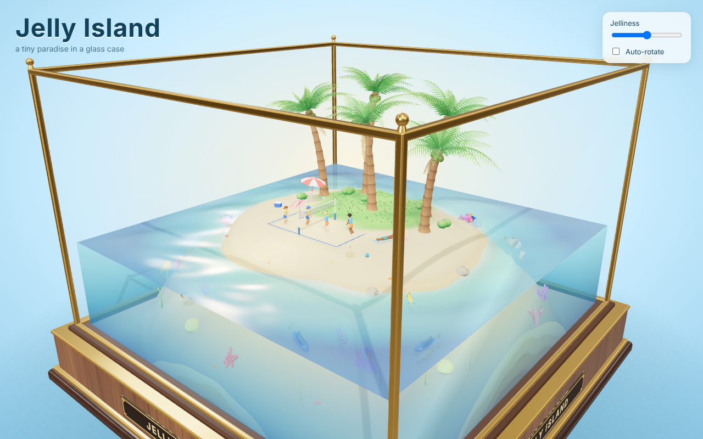
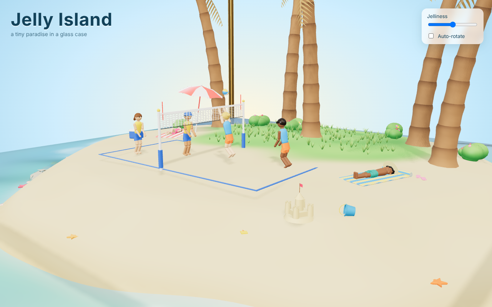
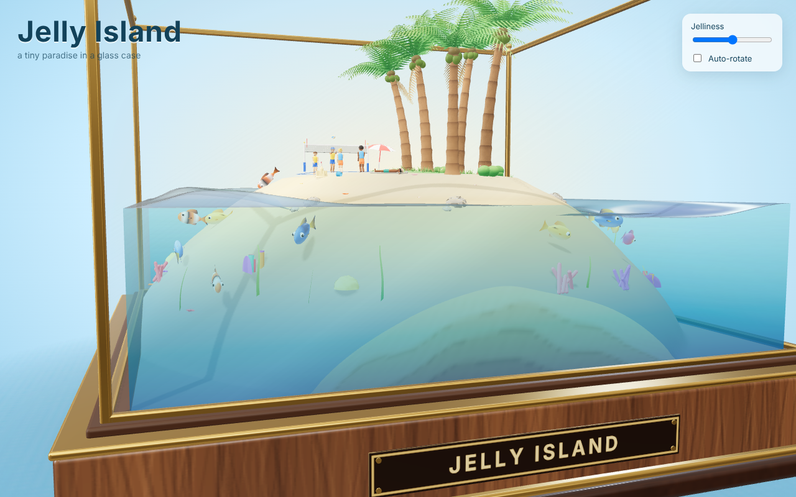
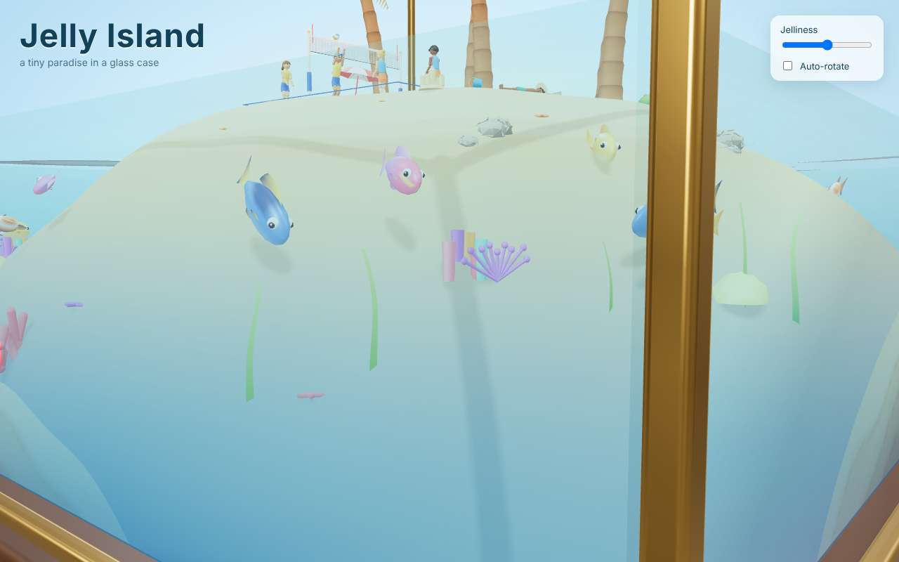

# Jelly Island

An interactive 3D showcase for the web: a glass display case on a wooden pedestal that you can orbit and
poke. Inside it, an island sits in an ocean that **behaves like jelly** whenever you rotate the view or click.

- **Ocean** – always-moving swell, plus a physical wave simulation that wobbles like gelatin after every
  click or orbit, then slowly settles.
- **Island + coconut palms** – jiggle slightly (squash/shear for the island, bending trunks and flapping
  fronds for the palms). The people on the island deliberately do **not** jiggle.
- **Beach life** – two sunbathers (towels, sunglasses, a beach umbrella) and a 2v2 beach-volleyball rally.
- **Fish** – a school of colourful fish. When the sea moves aggressively they panic: speed up, dive, bulge
  their eyes, pale, and flee toward the island's flanks. They relax again as the water calms.
- **Only web tech**: [three.js](https://threejs.org) + [Vite 8](https://vite.dev). No image/model assets: every
  texture is drawn on a canvas and every model is built from primitives in code.

| The showcase | On the beach |
| --- | --- |
|  |  |

| Cut-away side view (the island is solid down to the seabed) | Under the sea |
| --- | --- |
|  |  |

## Quick start

Requires Node 20.19+ or 22.12+ (Vite 8 requirement; developed on Node 22/24).

```bash
npm install
npm run dev        # http://localhost:5273
```

```bash
npm run build      # production bundle in dist/ (relative base, host anywhere)
npm run preview    # serve dist/ on http://localhost:4273
npm test           # unit tests for the pure simulation code (no browser needed)
npm run qa:views   # render the QA camera set to qa-output/ (see docs/VISUAL-QA.md)
npm run qa:perf    # draw calls, triangles, CPU/GPU cost per scene group
npm run qa:reload  # refresh the page many times; every load must become ready and keep animating
npm run smoke      # headless-browser end-to-end check (needs `npm run preview` running, see docs/REPRODUCING.md)
```

## Using it

- **Drag** to orbit, **scroll** to zoom (damped, so the jelly keeps wobbling as the camera glides to a stop).
- **Click** the sea (big wobble, fish flee), the island (it squashes), or a palm (it sways and its neighbours
  follow).
- **Jelliness** slider: 0 = rigid showcase, 2 = very wobbly. **Auto-rotate** toggle.
- **Colors**: pick the Sea, Sand, Grass and Sky colours; all the related shades (shallow/deep water, wet sand, grass tips, sky edge) follow. Remembered in your browser; **Reset colors** restores the defaults.
- Add `?debug=1` to the URL for a live read-out (fps, camera speed, sea activity, fish fear).

## Where things are

| Path | What |
| --- | --- |
| `src/main.js` | Renderer, scene, lights, camera, input, UI wiring, main loop, `window.__JELLY__` test hook |
| `src/config.js` | **All tuning constants** (dimensions, wave physics, fish fear thresholds) |
| `src/theme.js` | Default colours + `rel()` palette derivation for the colour pickers |
| `src/sim/` | Pure JS, no three.js: `spring.js`, `waveGrid.js` (water physics), `islandShape.js` (height field + layout), `jellyState.js` (shared interaction state) |
| `src/world/` | Scene objects: `showcase.js`, `ocean.js`, `island.js`, `palms.js`, `people.js`, `fish.js`, `props.js` (rocks, grass, bushes, shells, sandcastle, corals, seaweed) |
| `src/util/` | `bake.js` (merge static meshes into one draw call), `rng.js` (seeded random) |
| `src/fx/textures.js` | Canvas-drawn textures |
| `tests/` | `node --test` unit tests for `src/sim` |
| `scripts/smoke-test.mjs` | Playwright end-to-end check |
| `docs/` | Architecture, reproduction recipe, decisions, screenshots |

## Documentation

- [`docs/ARCHITECTURE.md`](docs/ARCHITECTURE.md) – how it works: coordinate system, the jelly model, per-object behaviour, calibration.
- [`docs/REPRODUCING.md`](docs/REPRODUCING.md) – the original brief, a build-from-scratch recipe for another agent, verification, gotchas.
- [`docs/VISUAL-QA.md`](docs/VISUAL-QA.md) – how problems are found (named camera views + checklists) and how models are polished; perf method; case log.
- [`docs/DECISIONS.md`](docs/DECISIONS.md) – why it is built this way, and ideas for next steps.
- [`AGENTS.md`](AGENTS.md) – rules of the road for AI agents (and humans) changing this repo.
